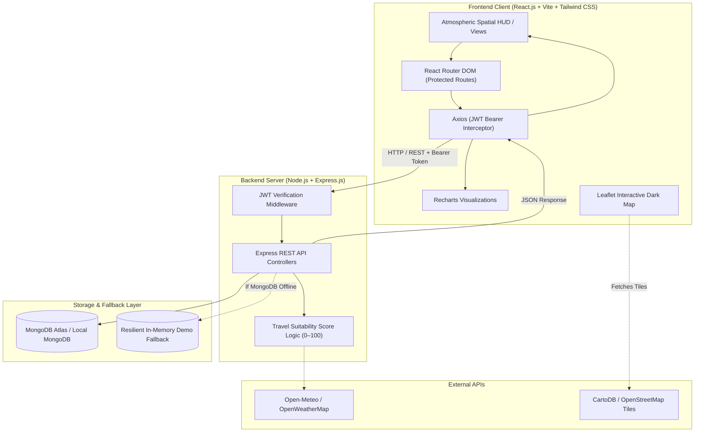

# 🧭 VOYARA — Smart Travel Planning & Weather Intelligence
> **Project Type:** Academic / College Final Evaluation Project  
> **Tech Stack:** MERN Stack (MongoDB, Express.js, React.js, Node.js)  
> **Target Audience:** College Evaluation Panel, External Examiners, & Everyday Travelers  
> **Special Note:** Engineered with built-in resilient demo fallbacks for flawless viva presentations.

---

## 📌 Table of Contents
1. [Project Abstract & Problem Statement](#-project-abstract--problem-statement)
2. [Objectives & Academic Significance](#-objectives--academic-significance)
3. [System Architecture & Data Flow](#-system-architecture--data-flow)
4. [Tech Stack Breakdown](#-tech-stack-breakdown)
5. [Core Modules & Functionalities](#-core-modules--functionalities)
6. [Database Schema (MongoDB / Mongoose)](#-database-schema-mongodb--mongoose)
7. [REST API Documentation](#-rest-api-documentation)
8. [Installation & Execution Guide](#-installation--execution-guide)
9. [4-Minute Live Viva Presentation Script](#-4-minute-live-viva-presentation-script)
10. [Frequently Asked Viva Voce Questions & Answers](#-frequently-asked-viva-voce-questions--answers)
11. [Project Directory Tree](#-project-directory-tree)
12. [Academic Disclaimer & Acknowledgments](#-academic-disclaimer--acknowledgments)

---

## 📖 Project Abstract & Problem Statement

### The Problem
When planning a travel journey, users typically juggle **four separate, disconnected applications**:
1. **Weather Forecast Apps** to check temperature and rain risk.
2. **Mapping & Navigation Services** to find attractions, cafés, and lodging.
3. **Notes / To-Do Apps** to draft daily schedules and itineraries.
4. **Spreadsheets or Calculators** to log expenses and ensure they do not exceed their budget.

This fragmented workflow creates cognitive friction, miscalculated travel costs, and ruined plans when outdoor activities clash with unexpected bad weather.

### The Proposed Solution: Voyara
**Voyara** brings trip planning, live meteorological intelligence, interactive spatial discovery, and budget monitoring onto a **single unified platform**. 

Built as a college project demonstrating **full-stack MERN engineering**, Voyara correlates scheduled outdoor activities with live meteorological forecasts, calculates an automated **Travel Suitability Score (0–100)**, displays interactive **dark-mode maps**, and issues live **overspending alerts** when expenses cross 80% or 100% of planned funds.

---

## 🎯 Objectives & Academic Significance

* **Demonstrate Full-Stack CRUD:** Seamless Create, Read, Update, and Delete operations across Trips, Itineraries, Expenses, and Wishlist spots.
* **Stateless Authentication & Security:** Password hashing via `bcryptjs` (salt rounds: 10) and session verification with **JSON Web Tokens (JWT)**.
* **Third-Party API Integration:** Real-time weather and 5-day forecast queries (with an automatic open fallback so the demo never fails even offline or without external API keys).
* **Interactive Data Visualizations:** Dynamic temperature trajectory curves and category spend donut charts built using **Recharts**.
* **Zero-Cost Interactive Mapping:** Tile-based cartography using **Leaflet.js** and **OpenStreetMap (CartoDB Dark Matter)**, eliminating the need for paid credit-card-gated Google Maps APIs.

---

## 🏗 System Architecture & Data Flow



---

## 💻 Tech Stack Breakdown

### Frontend (Client-Side)
| Technology | Version | Purpose in Voyara | Academic / Viva Merit |
| :--- | :--- | :--- | :--- |
| **React.js (Vite)** | 18.x | Component-based Single Page Application (SPA) | Lightning-fast HMR and modular UI composition. |
| **Tailwind CSS** | 3.4.x | Utility-first styling & weather gradients | Enables dynamic weather-responsive background changes. |
| **React Router DOM** | 6.x | Declarative routing & Protected Routes | Protects private user pages from unauthenticated access. |
| **Recharts** | 2.x | 5-day temperature curve & budget donut charts | Declarative React SVG charts without heavy dependencies. |
| **React-Leaflet** | 4.x | Interactive maps with glowing POI pins | 100% free open-source map integration with no credit cards. |
| **Axios** | 1.x | Asynchronous HTTP client | Centralized JWT token attachment via request interceptors. |
| **Lucide React** | 0.46x | UI iconography | Clean, lightweight icon suite. |

### Backend (Server-Side)
| Technology | Version | Purpose in Voyara | Academic / Viva Merit |
| :--- | :--- | :--- | :--- |
| **Node.js** | 18+ / 20+ | Asynchronous event-driven runtime | High-throughput non-blocking I/O. |
| **Express.js** | 4.21.x | REST API server framework | Clean route modularization and middleware architecture. |
| **JSON Web Token** | 9.x | Stateless session authentication | Demonstrates standard token authorization. |
| **bcryptjs** | 2.4.x | One-way salted password hashing | Demonstrates industry-standard credential security. |
| **Mongoose** | 8.x | Object Data Modeling (ODM) for MongoDB | Enforces schema validation and type safety. |
| **Cors & Dotenv** | — | Cross-Origin resource sharing & env config | Standard full-stack security practices. |

---

## 🧩 Core Modules & Functionalities

### 1. Authentication & Security Module
* **Registration & Login:** Validates user credentials, creates new accounts, and hashes passwords with `bcryptjs`.
* **JWT Protected Routes:** Issues signed tokens valid for 30 days. Protected routes on both frontend and backend reject unauthenticated requests.
* **1-Click Viva Demo Mode:** A dedicated button on the login screen automatically logs into a pre-configured student profile with pre-populated trips, expenses, and itinerary items for instant examination.

### 2. Weather Intelligence Engine
* **Real-Time Meteorology:** Delivers temperature, humidity, wind velocity, and sky conditions.
* **Travel Suitability Score (0–100 Formula):**
  $$\text{Score} = 100 - \Delta_{\text{Temp}} - \Delta_{\text{Condition}} - \Delta_{\text{Wind}} - \Delta_{\text{Humidity}}$$
  * Deducts points if too hot ($>32^\circ\text{C}$), too cold ($<12^\circ\text{C}$), raining ($-30$), stormy ($-45$), snowy ($-25$), or windy ($>25\text{ km/h}$).
  * **Classification Tiers:**
    * **Ideal (80–100):** Emerald badge — Recommended for walking tours and photography.
    * **Good (60–79):** Sky Blue badge — Suitable for city walks and parks.
    * **Moderate (40–59):** Amber badge — Breezy/overcast, pack light layers.
    * **Poor (<40):** Coral Red badge — Inclement weather, focus on museums and indoor cafés.
* **Weather-Aware Activity Guidance:** Dynamically maps live conditions to actionable recommendations (e.g., recommends indoor cafés during rain and sunset walks during clear days).

### 3. Spatial HUD Interface (Atmospheric UI/UX)
* **Zero-Scroll Cinematic Viewport:** An editorial Heads-Up Display anchored by a bottom-up dark scrim.
* **3D Destination Portal Window:** A rounded pill card (`border-radius: 90px`) featuring 3D perspective parallax tracking that tilts toward cursor movement.
* **Dynamic Sky Backgrounds:** Automatically shifts color palettes based on active destination weather (warm amber for clear skies, slate blue for clouds, deep storm navy for rain).
* **Split Hero Anchor:** Condensed typography destination title paired with a 4-row meteorological/budget fact table.

### 4. Smart Trip Planning & Itinerary Module
* **Trip Management (CRUD):** Create new trips with destination, start date, end date, notes, and planned budget.
* **Automated Countdown Timer:** Computes remaining days until departure (*"Starts in 12 days"*, *"Starts Tomorrow!"*, *"Trip Completed"*).
* **Day-Wise Schedule:** Allows adding timed activities under categories (*Outdoor, Indoor, Food, Travel*).
* **Weather Conflict Alert:** Flags outdoor activities with an amber warning pill if forecasted weather on that day predicts rain or storms.

### 5. Interactive Map & POI Discovery
* **Interactive Leaflet Canvas:** Centered on destination coordinates using CartoDB Dark Matter tiles.
* **Categorized Glowing Markers:** Custom pinging markers for Attractions (Emerald), Cafés/Restaurants (Amber), and Hotels (Blue).
* **Wishlist Bookmarking:** One-click save to preserve points of interest to the user's personal travel wishlist.

### 6. Budget & Expense Visualizer
* **Expense Tracker (CRUD):** Log expenditures under *Food, Travel, Stay, Shopping,* or *Activities*.
* **Recharts Donut Chart:** Visual distribution breakdown of total spend across categories.
* **Live Balance Engine:** Automatically updates Total Spent, Remaining Cushion, and Utilization Percentage.
* **Automated Overspending Banners:**
  * **Amber Warning (80%):** Triggers when expenses consume $\ge 80\%$ of budget.
  * **Red Alert (100%+):** Slides down with an alert when expenses exceed total budget.
  * **Viva Demo Simulator:** One-click button in the UI to instantly simulate a budget overrun live on screen during presentations.

---

## 🗄 Database Schema (MongoDB / Mongoose)

```text
├── User Collection
│   ├── name: String (required)
│   ├── email: String (unique, required)
│   ├── password: String (bcrypt hashed)
│   └── preferredUnit: 'C' | 'F'
│
├── Trip Collection
│   ├── userId: ObjectId (ref: User)
│   ├── destination: String
│   ├── startDate: Date
│   ├── endDate: Date
│   ├── budget: Number
│   ├── notes: String
│   └── itinerary: [
│         { day: Number, time: String, activity: String, type: String, notes: String }
│       ]
│
├── Expense Collection
│   ├── tripId: ObjectId (ref: Trip)
│   ├── userId: ObjectId (ref: User)
│   ├── title: String
│   ├── amount: Number
│   ├── category: 'Food' | 'Travel' | 'Stay' | 'Shopping' | 'Activities'
│   └── date: Date
│
└── SavedPlace Collection
    ├── userId: ObjectId (ref: User)
    ├── placeName: String
    ├── city: String
    ├── category: String
    ├── lat: Number
    └── lng: Number
```

---

## 🔌 REST API Documentation

| Method | Endpoint | Description | Auth Required |
| :--- | :--- | :--- | :--- |
| `POST` | `/api/auth/register` | Register new user account | No |
| `POST` | `/api/auth/login` | Login user & return JWT token | No |
| `POST` | `/api/auth/demo-login` | 1-Click login for college viva evaluation | No |
| `GET` | `/api/auth/me` | Fetch logged-in user profile | Yes (Bearer) |
| `GET` | `/api/weather/destinations` | Curated top destinations with live weather | No |
| `GET` | `/api/weather/current?city=X` | Live weather, score & POIs for any city | No |
| `GET` | `/api/weather/saved` | Fetch user's bookmarked wishlist spots | Yes (Bearer) |
| `POST` | `/api/weather/save` | Bookmark a spot to wishlist | Yes (Bearer) |
| `DELETE` | `/api/weather/saved/:id` | Remove a spot from wishlist | Yes (Bearer) |
| `GET` | `/api/trips` | Fetch all trips with countdowns & spend | Yes (Bearer) |
| `GET` | `/api/trips/:id` | Get specific trip details & itinerary | Yes (Bearer) |
| `POST` | `/api/trips` | Create a new trip | Yes (Bearer) |
| `PUT` | `/api/trips/:id` | Update trip details or budget | Yes (Bearer) |
| `DELETE` | `/api/trips/:id` | Delete trip and its expenses | Yes (Bearer) |
| `POST` | `/api/trips/:id/itinerary` | Add day-wise activity to a trip | Yes (Bearer) |
| `GET` | `/api/expenses/trip/:tripId` | Fetch expenses, donut breakdown & alerts | Yes (Bearer) |
| `POST` | `/api/expenses` | Log a new expense | Yes (Bearer) |
| `DELETE` | `/api/expenses/:id` | Delete an expense | Yes (Bearer) |
| `GET` | `/api/health` | Server health check & status | No |

---

## 🚀 Installation & Execution Guide

### Prerequisites
* **Node.js** installed (version 18 or above). Check with: `node -v`
* **npm** installed. Check with: `npm -v`
* *(Optional)* MongoDB installed locally or a free MongoDB Atlas connection string. (Voyara has a built-in memory fallback so it runs immediately even without local MongoDB).

### Step 1: Start Backend Server
1. Open a terminal and navigate to the `Backend` directory:
   ```bash
   cd Backend
   ```
2. Install dependencies (if not already installed):
   ```bash
   npm install
   ```
3. Start the server:
   ```bash
   node server.js
   ```
   *The server will run on `http://localhost:5000`.*

### Step 2: Start Frontend Client
1. Open a **second terminal** and navigate to the `Frontend` directory:
   ```bash
   cd Frontend
   ```
2. Install dependencies (if not already installed):
   ```bash
   npm install
   ```
3. Start the Vite development server:
   ```bash
   npm run dev
   ```
   *The application will launch on `http://localhost:5173`.*

### Step 3: Run Automated Verification Tests
To confirm that all API routes and data computations work properly, run the built-in test suite:
```bash
cd Backend
node test-api.js
```
*Executes all 6 end-to-end integration tests (Auth, Trips, Weather, Expenses, Suitability) and outputs results directly in the terminal.*

---

## 🎤 4-Minute Live Viva Presentation Script

When demonstrating Voyara to your evaluators or external examiners, follow this 4-step walkthrough:

```
[Minute 1: Authentication & Overview]
   │
   ├─► Click "Launch 1-Click Demo Profile" on the Login page.
   └─► Explain: "Passwords are encrypted using bcrypt salt rounds, and the session is
                 managed statelessly via JSON Web Tokens passed in HTTP Bearer headers."

[Minute 2: Atmospheric HUD & Weather Intelligence]
   │
   ├─► Show the full-viewport HUD on /explore. Switch between Kyoto, Reykjavik, and Manali.
   ├─► Point out the dynamic background shifts matching live meteorological conditions.
   ├─► Show the Travel Suitability Score (0-100) and explain how point deductions work.
   └─► Scroll to the Recharts 5-day temperature curve and CartoDB Dark Matter map.

[Minute 3: Trip Scheduling & Weather Conflict Detection]
   │
   ├─► Navigate to /trips to show the automatic "Starts in X days" countdown timer.
   ├─► Open Trip Details (/trips/:id), show Day 1, 2, and 3 activities.
   └─► Point out the Weather Conflict Badge: outdoor activities show a warning pill 
       if rain or storm is forecasted.

[Minute 4: Fiscal Engine & Overspending Demonstration]
   │
   ├─► Navigate to /budget to show the Category Spend Donut Chart.
   ├─► Click "Simulate Overspending Warning (Viva Demo)" or log a large expense.
   └─► Show the Overspending Warning banner triggering live at 80% / 100% utilization.
```

---

## ❓ Frequently Asked Viva Voce Questions & Answers

### Q1: Why did you choose the MERN stack over Python/Django or PHP?
> **Answer:** *"The MERN stack provides an end-to-end JavaScript environment. Both the frontend (React) and backend (Node.js/Express) share the same language, eliminating serialization overhead. Furthermore, JSON is natively supported across MongoDB documents, Express REST APIs, and React state."*

### Q2: How does JWT authentication work and where is the token stored?
> **Answer:** *"When the user logs in, the backend signs a payload with a secret key using `jsonwebtoken`. The client receives this token and stores it in browser `localStorage`. On all subsequent API calls, an Axios request interceptor attaches the token as `Authorization: Bearer <token>`. The backend middleware verifies the signature before processing the request."*

### Q3: How is the Travel Suitability Score computed?
> **Answer:** *"It is a rule-based algorithm starting at 100 points. Penalties are deducted based on temperature thresholds (penalizing temperatures above 32°C or below 12°C), conditions (rain: -30 pts, storms: -45 pts, snow: -25 pts), wind speeds exceeding 25 km/h, and high humidity. It categorizes destinations into Ideal, Good, Moderate, or Poor tiers."*

### Q4: Why use Leaflet.js instead of Google Maps?
> **Answer:** *"Google Maps requires setting up a billing account and credit card verification, which can cause unexpected charges or quota blocks during presentations. Leaflet is open-source, completely free, and works reliably with OpenStreetMap tiles and CartoDB Dark Matter styling."*

### Q5: What happens if MongoDB is not running on the evaluator's computer?
> **Answer:** *"Voyara is built with an automatic fallback architecture. In `Backend/config/db.js`, the app attempts to connect to MongoDB. If it detects that a local MongoDB instance is not active, it transparently routes queries to an in-memory repository store so the demonstration proceeds smoothly without crashes."*

---

## 📁 Project Directory Tree

```text
voyara/
├── Frontend/                           # React Frontend (Vite + Tailwind CSS)
│   ├── src/
│   │   ├── components/               # UI components
│   │   │   ├── Navbar.jsx            # Floating pill navigation
│   │   │   ├── PortalHUD.jsx         # Flagship 3D portal & weather HUD
│   │   │   ├── SuitabilityGauge.jsx  # 0-100 score ring & activity advice
│   │   │   ├── ForecastChart.jsx     # Recharts 5-day temperature curve
│   │   │   ├── MapView.jsx           # Leaflet interactive dark map
│   │   │   ├── BudgetOverview.jsx    # Donut chart & overspending alerts
│   │   │   ├── ItineraryDrawer.jsx   # Day-wise scheduler & rain warnings
│   │   │   └── ProtectedRoute.jsx    # Client-side JWT route protection
│   │   ├── context/
│   │   │   └── AuthContext.jsx       # Global auth state & viva demo login
│   │   ├── pages/
│   │   │   ├── Explore.jsx           # Discovery, live search & maps
│   │   │   ├── Trips.jsx             # User trips with countdowns
│   │   │   ├── TripDetails.jsx       # Deep-dive itinerary & budget
│   │   │   ├── Budget.jsx            # Fiscal engine & overspending simulator
│   │   │   ├── Login.jsx             # Sign in & 1-click viva demo button
│   │   │   └── Register.jsx          # User registration form
│   │   ├── utils/
│   │   │   ├── api.js                # Axios instance with auth interceptor
│   │   │   └── weatherThemes.js      # Weather gradient & badge helpers
│   │   ├── App.jsx                   # Route declarations
│   │   ├── index.css                 # Tailwind & atmospheric styling
│   │   └── main.jsx
│   ├── index.html
│   ├── tailwind.config.js
│   ├── vite.config.js
│   └── package.json
│
├── Backend/                            # Node.js + Express REST API
│   ├── config/
│   │   └── db.js                     # MongoDB connection & viva fallback store
│   ├── controllers/
│   │   ├── authController.js         # Register, login, demo login
│   │   ├── tripController.js         # Trip CRUD & countdown calculation
│   │   ├── expenseController.js      # Expenses & 80%/100% alert logic
│   │   └── weatherController.js      # Suitability score & live weather
│   ├── middleware/
│   │   └── authMiddleware.js         # JWT bearer token verification
│   ├── models/
│   │   ├── User.js                   # User schema with bcrypt pre-hook
│   │   ├── Trip.js                   # Trip schema with embedded itineraries
│   │   ├── Expense.js                # Expense category schema
│   │   └── SavedPlace.js             # Wishlist places schema
│   ├── routes/
│   │   ├── authRoutes.js
│   │   ├── tripRoutes.js
│   │   ├── expenseRoutes.js
│   │   └── weatherRoutes.js
│   ├── .env                          # Server configuration
│   ├── server.js                     # Entry point & CORS/route mounting
│   ├── test-api.js                   # 6-step integration test script
│   └── package.json
│
├── prd_mern_stack.md                 # Product Requirements Document
├── tech_stack_mern.md                # System Architecture & viva guide
├── ui_ux_motion_design_document.md   # Spatial HUD UI/UX motion design guide
└── README.md                         # This file
```

---

## 📜 Academic Disclaimer & Acknowledgments
* This project is developed solely for **academic evaluation, viva presentation, and educational learning purposes**.
* Built using open-source packages: [React.js](https://react.dev/), [Express.js](https://expressjs.com/), [Node.js](https://nodejs.org/), [Tailwind CSS](https://tailwindcss.com/), [Recharts](https://recharts.org/), and [Leaflet](https://leafletjs.com/).
* Map tiles provided by [OpenStreetMap](https://www.openstreetmap.org/) and [CARTO](https://carto.com/).
