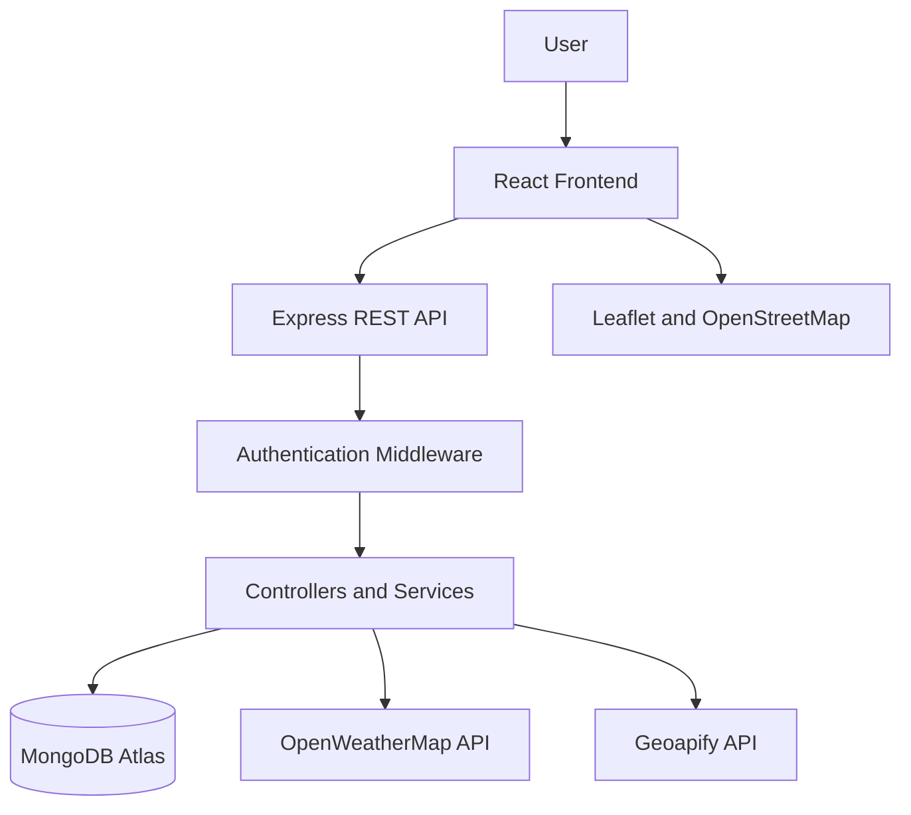
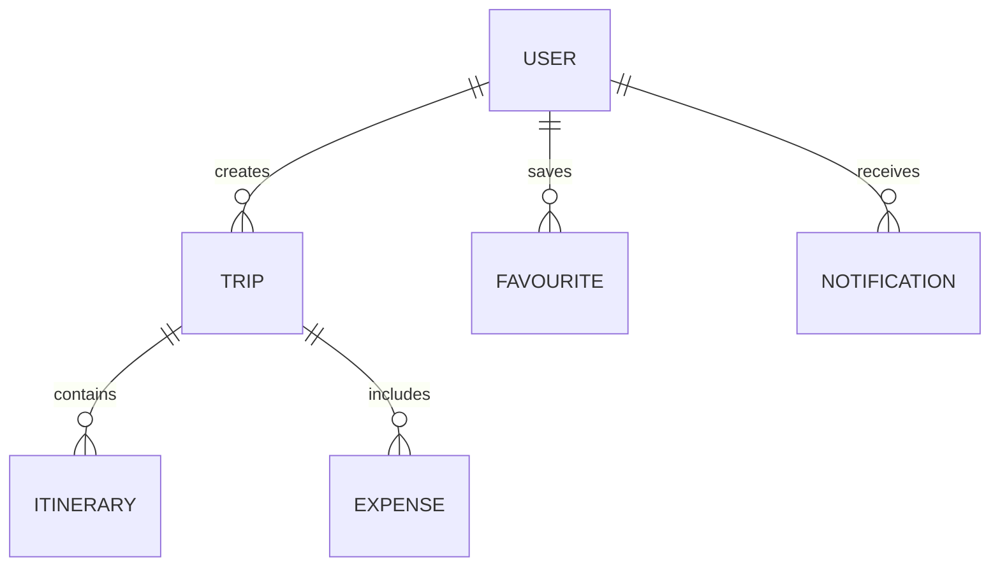

<div align="center">

# VOYARA

### Your journey, beautifully planned.

A weather-intelligent travel planning platform that brings destination discovery, personalized itineraries, interactive maps and travel expense management into one immersive experience.


</div>

---

## Overview

Voyara is a full-stack travel planning and weather intelligence platform designed to simplify the way people discover, plan and experience their journeys.

By combining real-time weather information, interactive maps, personalized trip management and budget tracking, Voyara aims to help travellers make informed decisions throughout their journey.

The platform features a cinematic, weather-responsive liquid-glass interface that dynamically adapts to the selected destination's atmospheric conditions, creating an immersive and intuitive travel planning experience.

## Key Features

The following features define Voyara's development scope.

### Weather Intelligence

- Real-time destination weather information.
- Interactive weather forecast visualizations.
- Temperature, humidity and wind speed insights.
- Dynamic weather-responsive backgrounds.
- Weather-aware activity recommendations.
- Rule-based travel suitability score.

### Smart Trip Planning

- Create, view, update and delete trips.
- Personalized day-wise itineraries.
- Activity scheduling and management.
- Upcoming and completed trip tracking.
- Trip duration and countdown calculations.
- Weather-informed itinerary suggestions.

### Destination Discovery

- Search cities and travel destinations.
- Explore nearby tourist attractions.
- Discover restaurants, cafés and accommodation.
- Interactive maps with location markers.
- Save and manage favourite destinations.

### Budget Management

- Set personalized trip budgets.
- Add, edit and delete travel expenses.
- Category-wise expense management.
- Budget utilization and remaining balance.
- Visual expense analytics.
- Overspending notifications.

### Authentication and Personalization

- Secure user registration and login.
- JWT-based authentication.
- Password hashing using bcrypt.
- Protected application routes.
- Personalized user dashboard.
- Profile and preference management.
- User-specific data access.

## User Interface

Voyara follows a cinematic design philosophy inspired by modern liquid-glass interfaces.

The interface is designed around:

- Full-screen cinematic landscapes.
- Weather-responsive dynamic backgrounds.
- Translucent glass components.
- Floating icon-based navigation.
- Animated SVG forecast charts.
- Smooth page transitions.
- Minimal and modern typography.
- Responsive layouts across devices.
- Accessible interactions and reduced-motion support.

**Design Inspiration:** [MotionSites Forecast Center](https://motionsites.ai/?prompt=forecast-center)

## Technology Stack

### Frontend

| Technology | Purpose |
|------------|---------|
| React.js | Component-based user interface |
| Vite | Development and build tooling |
| JavaScript | Application logic |
| CSS3 | Custom liquid-glass styling |
| React Router | Client-side navigation |
| Motion | Animations and transitions |
| Lucide React | Interface icons |
| Axios | HTTP requests |
| Context API | Global state management |
| React Leaflet | Interactive maps |
| Recharts | Expense analytics |

### Backend

| Technology | Purpose |
|------------|---------|
| Node.js | Server-side runtime |
| Express.js | REST API development |
| Mongoose | MongoDB object modelling |
| JWT | User authentication |
| bcryptjs | Password hashing |
| Helmet | HTTP security headers |
| CORS | Cross-origin request management |
| dotenv | Environment configuration |
| Express Rate Limit | API rate limiting |

### Database

| Technology | Purpose |
|------------|---------|
| MongoDB Atlas | Cloud database |
| Mongoose | Schema validation and data modelling |

### External APIs

| Service | Purpose |
|---------|---------|
| OpenWeatherMap | Weather and forecast information |
| Geoapify | Geocoding and destination discovery |
| OpenStreetMap | Geographic map data |
| Leaflet | Interactive map rendering |

## System Architecture



Voyara follows a modular client-server architecture with a clear separation between presentation, application logic, database operations and external API integrations.

## Database Architecture

The planned database consists of six primary collections.

| Collection | Description |
|------------|-------------|
| Users | User accounts and preferences |
| Trips | Travel plans and trip information |
| Itineraries | Day-wise activities and schedules |
| Expenses | Travel expenses and budget records |
| Favourites | Saved travel destinations |
| Notifications | User reminders and application alerts |



## CRUD Operations

Voyara is designed to implement complete CRUD functionality across its core modules.

| Module | Create | Read | Update | Delete |
|--------|:------:|:----:|:------:|:------:|
| Trips | Yes | Yes | Yes | Yes |
| Itineraries | Yes | Yes | Yes | Yes |
| Expenses | Yes | Yes | Yes | Yes |
| Saved Destinations | Yes | Yes | Yes | Yes |
| User Profiles | Yes | Yes | Yes | Yes |

All personal resources are intended to be persisted in MongoDB and protected through authenticated, ownership-based access control.

## Weather-Aware Travel Planning

Voyara's core differentiating feature is its ability to incorporate weather conditions into the travel planning experience.

The recommendation engine evaluates available weather information and suggests suitable activity categories.

| Weather Condition | Suggested Activities |
|-------------------|----------------------|
| Clear skies | Sightseeing and outdoor exploration |
| Rain | Museums, cafés and indoor attractions |
| Cloudy | City exploration and photography |
| High temperature | Shaded and indoor activities |
| Snow | Suitable winter experiences |
| Thunderstorm | Postpone exposed outdoor activities |

The travel suitability score is designed to consider temperature, precipitation, wind speed and atmospheric conditions.

These recommendations are informational and do not replace official weather advisories or travel safety guidance.

## Project Structure

```text
Voyara/
│
├── frontend/
│   ├── public/
│   │   └── backgrounds/
│   │
│   ├── src/
│   │   ├── assets/
│   │   ├── components/
│   │   ├── context/
│   │   ├── hooks/
│   │   ├── layouts/
│   │   ├── pages/
│   │   ├── services/
│   │   ├── styles/
│   │   ├── utils/
│   │   ├── App.jsx
│   │   └── main.jsx
│   │
│   ├── .env.example
│   ├── package.json
│   └── vite.config.js
│
├── backend/
│   ├── config/
│   ├── controllers/
│   ├── middleware/
│   ├── models/
│   ├── routes/
│   ├── services/
│   ├── utils/
│   ├── tests/
│   ├── .env.example
│   ├── server.js
│   └── package.json
│
├── .gitignore
└── README.md
```

The project follows a modular architecture to improve maintainability, scalability and code reusability.

## Getting Started

### Prerequisites

Ensure the following are available:

- Node.js compatible with the installed Vite version.
- npm.
- Git.
- MongoDB Atlas account.
- OpenWeatherMap API key.
- Geoapify API key.

### 1. Clone the Repository

```bash
git clone https://github.com/AayanSrivastwa/Voyara.git
cd Voyara
```

### 2. Install Frontend Dependencies

```bash
cd frontend
npm install
```

### 3. Install Backend Dependencies

```bash
cd ../backend
npm install
```

### 4. Configure Environment Variables

Create a `.env` file inside the backend directory.

```env
PORT=5000
NODE_ENV=development

MONGODB_URI=your_mongodb_connection_string

JWT_SECRET=your_secure_jwt_secret
JWT_EXPIRES_IN=7d

OPENWEATHER_API_KEY=your_openweather_api_key
GEOAPIFY_API_KEY=your_geoapify_api_key

FRONTEND_URL=http://localhost:5173
```

Create a `.env` file inside the frontend directory.

```env
VITE_API_BASE_URL=http://localhost:5000/api
```

Never commit actual environment variables or sensitive credentials to GitHub.

### 5. Start the Backend

```bash
cd backend
npm run dev
```

Backend URL:

```text
http://localhost:5000
```

### 6. Start the Frontend

Open a separate terminal.

```bash
cd frontend
npm run dev
```

Frontend URL:

```text
http://localhost:5173
```

## REST API

The planned REST API is organized into the following modules.

### Authentication

| Method | Endpoint | Description |
|--------|----------|-------------|
| POST | `/api/auth/register` | Register a user |
| POST | `/api/auth/login` | Authenticate a user |
| POST | `/api/auth/logout` | Logout |
| GET | `/api/auth/me` | Get current user |
| PATCH | `/api/auth/profile` | Update profile |
| PATCH | `/api/auth/password` | Change password |

### Trip Management

| Method | Endpoint | Description |
|--------|----------|-------------|
| GET | `/api/trips` | Retrieve user trips |
| POST | `/api/trips` | Create a trip |
| GET | `/api/trips/:id` | Retrieve trip details |
| PATCH | `/api/trips/:id` | Update a trip |
| DELETE | `/api/trips/:id` | Delete a trip |

### Itinerary Management

| Method | Endpoint |
|--------|----------|
| GET | `/api/trips/:tripId/itineraries` |
| POST | `/api/trips/:tripId/itineraries` |
| PATCH | `/api/trips/:tripId/itineraries/:id` |
| DELETE | `/api/trips/:tripId/itineraries/:id` |

### Expense Management

| Method | Endpoint |
|--------|----------|
| GET | `/api/trips/:tripId/expenses` |
| POST | `/api/trips/:tripId/expenses` |
| PATCH | `/api/trips/:tripId/expenses/:id` |
| DELETE | `/api/trips/:tripId/expenses/:id` |

### Weather and Destination Services

| Method | Endpoint | Description |
|--------|----------|-------------|
| GET | `/api/weather/current` | Current weather |
| GET | `/api/weather/forecast` | Weather forecast |
| GET | `/api/destinations/search` | Search destinations |
| GET | `/api/places/nearby` | Nearby attractions |

## Security

Security is an integral part of Voyara's architecture.

The security design includes:

- JWT-based authentication.
- Secure password hashing using bcrypt.
- Protected frontend and backend routes.
- Ownership-based resource authorization.
- Server-side input validation.
- API rate limiting.
- Helmet security headers.
- Restricted CORS configuration.
- Environment-based secret management.
- Protection against NoSQL injection.
- Secure authentication cookie configuration.
- Centralized error handling.
- Backend-proxied external API requests.

## Performance and Accessibility

Voyara is designed with a focus on performance and usability.

- API response caching.
- Debounced destination search.
- Optimized background assets.
- Reusable React components.
- Responsive interface.
- Lazy loading where appropriate.
- Keyboard-accessible navigation.
- Reduced-motion support.
- Loading, empty and error states.

## Deployment

The planned deployment architecture consists of:

| Service | Platform |
|---------|----------|
| Frontend | Vercel |
| Backend | Render |
| Database | MongoDB Atlas |
| Version Control | GitHub |

Deployment links will be added after the application is hosted.

## Development Roadmap

- [x] Project initialization
- [x] MERN stack setup
- [x] UI design direction
- [ ] Cinematic liquid-glass dashboard
- [ ] MongoDB Atlas integration
- [ ] Authentication and authorization
- [ ] Trip management and CRUD
- [ ] Smart itinerary planner
- [ ] Live weather integration
- [ ] Weather suitability engine
- [ ] Interactive maps
- [ ] Destination discovery
- [ ] Budget and expense management
- [ ] Saved destinations
- [ ] Notifications
- [ ] Testing and security validation
- [ ] Production deployment

## Future Enhancements

- Collaborative trip planning.
- Shareable itineraries.
- AI-assisted itinerary generation.
- Multi-currency expense management.
- PDF itinerary export.
- Google OAuth authentication.
- Offline itinerary access.
- Email and push notifications.
- Route optimization..

## Learning Objectives

Voyara is developed to demonstrate practical implementation of:

- Full-stack MERN development.
- RESTful API architecture.
- Database modelling and relationships.
- Secure authentication and authorization.
- CRUD operations.
- Third-party API integration.
- Geospatial data visualization.
- Responsive UI/UX development.
- Application security.
- Cloud deployment.

## Acknowledgements

- [React](https://react.dev/)
- [MongoDB](https://www.mongodb.com/)
- [OpenWeatherMap](https://openweathermap.org/)
- [Geoapify](https://www.geoapify.com/)
- [OpenStreetMap](https://www.openstreetmap.org/)
- [Leaflet](https://leafletjs.com/)
- [MotionSites](https://motionsites.ai/)

## Author

**Aayan Srivastwa**

B.Tech Computer Science and Engineering — Cybersecurity

[GitHub](https://github.com/AayanSrivastwa)

---

<div align="center">

### VOYARA

**Discover smarter. Plan better. Travel beyond.**

Built with a passion for technology, design and exploration.

</div>
